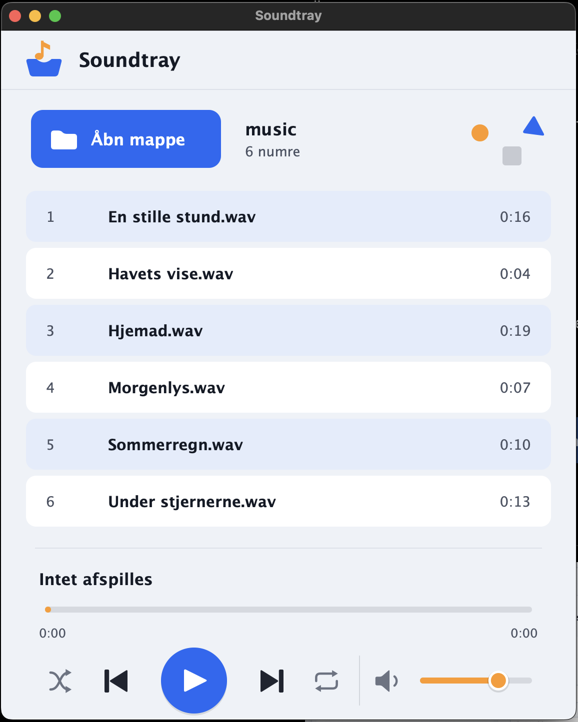

# Soundtray

En lille, let playlist-afspiller skrevet i C++ med [JUCE](https://juce.com).



## Funktioner

- **Åbn mappe** – alle lydfiler i mappen vises på playlisten (WAV, AIFF, FLAC, MP3, Ogg Vorbis – og på macOS/Windows også de formater systemet understøtter).
- **Afspilning** – afspil/pause, forrige/næste, spol i sangen, lydstyrke.
- **Gentag** – fra → hele listen → denne sang (klik på gentag-knappen for at skifte).
- **Bland (mix)** – afspil listen i tilfældig rækkefølge.
- Husker sidste mappe, lydstyrke, gentag og bland.

Genveje: `Mellemrum` afspil/pause · `Cmd/Ctrl+→` næste · `Cmd/Ctrl+←` forrige · `Cmd/Ctrl+O` åbn mappe · `Enter` afspil valgt sang.

## Installation

Hent den nyeste udgave under [Releases](https://github.com/shenphenchoedron-hue/Soundtray/releases):

| System | Fil | Installation |
|---|---|---|
| Windows 10/11 | `Soundtray-x.y.z-Windows-Setup.exe` | Kør installationsprogrammet |
| macOS 11+ | `Soundtray-x.y.z-macOS.dmg` | Træk Soundtray over i Programmer (første gang: højreklik → Åbn) |
| Ubuntu 22.04+ | `soundtray_x.y.z_ubuntu22.04_amd64.deb` | `sudo apt install ./soundtray_*_ubuntu22.04_amd64.deb` |
| Debian 12+ | `soundtray_x.y.z_debian12_amd64.deb` | `sudo apt install ./soundtray_*_debian12_amd64.deb` |

## Byg selv

Kræver CMake ≥ 3.22 og en C++17-compiler. JUCE hentes automatisk.

```sh
cmake -B build -DCMAKE_BUILD_TYPE=Release
cmake --build build --config Release
```

Linux kræver desuden: `libasound2-dev libfreetype6-dev libfontconfig1-dev libx11-dev libxcomposite-dev libxcursor-dev libxext-dev libxinerama-dev libxrandr-dev libxrender-dev`.

Pakker laves med `cpack` i build-mappen. GitHub Actions bygger og udgiver automatisk alle platforme, når et tag `v*` pushes.

## Licens

GPL-3.0 (se `LICENSE`). JUCE bruges under sin open source-licens (AGPLv3).
